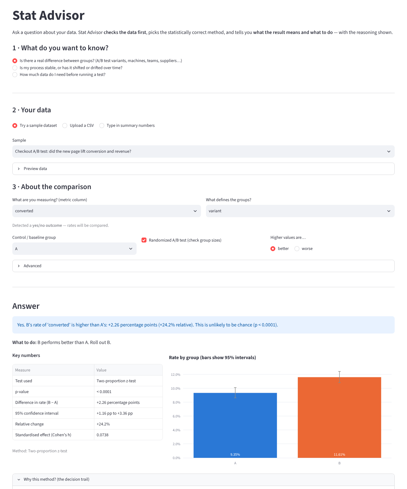
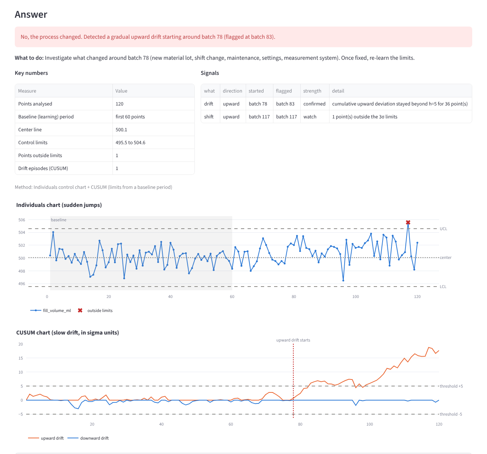
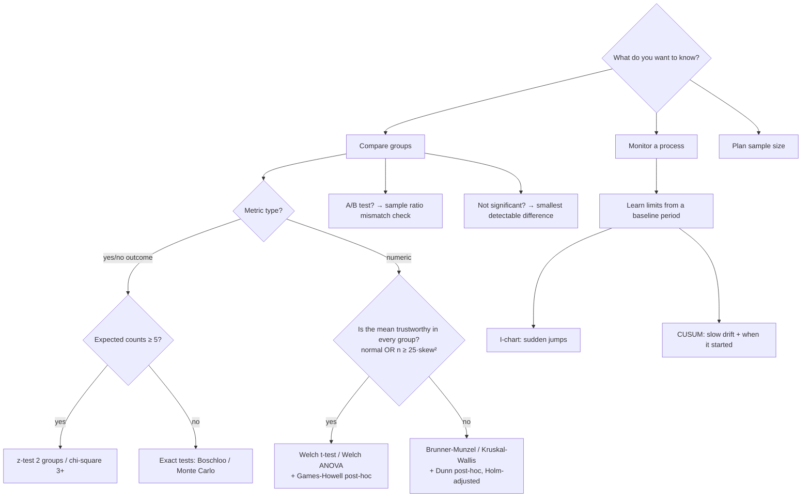
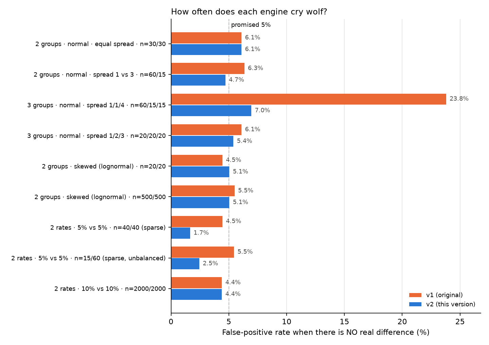

# Stat Advisor

**Ask a question about your data and get a trustworthy answer, with the reasoning shown.**

Most A/B-testing and quality dashboards run a t-test on everything and print a p-value. Stat Advisor works more like a careful statistician. It checks what the data actually looks like, picks a method whose assumptions hold, and answers in plain English: *what happened, how sure we are, and what to do next*. One engine handles A/B experiments, group comparisons (machines, teams, suppliers) and process monitoring over time.



## What it does

You pick one of three questions, give it data (a CSV, summary numbers, or a bundled sample), and get an answer.

| Your question | Example (bundled sample data) | What you get back |
|---|---|---|
| **Is there a real difference between groups?** | *Did the new checkout page lift conversion?* | "Yes. B's conversion is higher than A's: +2.26 percentage points (+24% relative), p < 0.0001. **Roll out B.**" It also checks that the traffic split wasn't broken (sample ratio mismatch). |
| | *Is one machine producing more defects?* | "Yes, the groups differ. The pairs that really differ are M3 vs M1 and M3 vs M2. **Focus on M3.**" |
| **Is my process stable, or drifting?** | *Is the bottle-filling line drifting?* | "No, the process changed. A gradual upward drift started around batch 78. **Investigate what changed there.**" A standard 3σ chart alone stayed silent until batch 117, 34 batches later. |
| **How much data do I need?** | *Baseline conversion 10%, want to detect a 10% lift* | "About 14,745 users per group — roughly 15 days at 2,000 users/day." |

Every answer comes with:

- **The key numbers:** the difference, its confidence interval, relative lift and effect size.
- **A decision trail:** why this method was chosen, for example "group B is skewed (skewness 2.3) and too small (n = 22) for the Central Limit Theorem, so a rank-based test was used".
- **Warnings** when the result shouldn't be trusted.
- **A downloadable Markdown report.**



## How it decides



Full reasoning, references and limitations: **[docs/METHODOLOGY.md](docs/METHODOLOGY.md)**.

## Does it actually work? (calibration study)

A test at α = 5% promises to cry wolf only 5% of the time when nothing is going on. The study simulates thousands of datasets where the truth is known and counts how often each version of the engine is fooled.



Headline results (2,000 simulated datasets per scenario; Monte Carlo error ≈ ±0.5 points):

- **Unequal spreads across 3 groups:** v1 raised a false alarm **23.8%** of the time, v2 **7.0%**. Welch's ANOVA is known to run slightly above 5% with small, high-variance groups.
- **Everywhere else,** v2's false-positive rate stays between 4.7% and 6.1%, and its power matches v1. The 6.1% in the first row is simulation noise: a plain Welch t-test on the same simulated data scores 6.0%.
- **Sparse conversion data:** v2 uses exact tests, which are conservative (1.7–2.5% false positives). That is safe, at some cost in power.
- **Process monitoring** (100-point series, 1σ shift at point 50): v1 got it right (flagged the shift and nothing before it) in only **9%** of runs, because its CUSUM measured drift from an average that already included the shift. v2 gets it right in **88%** of runs. False alarms on stable series drop from 39% for any signal to **18%** when counting confirmed signals only.
- **Honest trade-off:** with heavy-tailed data (t, 3 df), comparing averages has less power than rank tests (89% vs 98%). That is why `focus="typical"` exists. With unequal spreads the rank tests themselves can over-reject (11.7% in the 3-group case), so the default stays with averages and the app warns.

Full tables: [simulations/results.md](simulations/results.md). Reproduce with `python -m simulations.calibration_study` (prints each scenario as it finishes; `--quick` for a ~1-minute smoke run, `--reps 500` for a faster full run).

### What changed from v1

The original version (kept in `simulations/legacy_v1.py` for comparison) had these defects. Each one now has a regression test.

| Defect in v1 | Effect | Fix |
|---|---|---|
| 3+ groups compared with classic ANOVA even when spreads differ | **23% false positives** instead of 5% | Welch's ANOVA + Games-Howell |
| Shapiro-Wilk alone decided "normal or not" | Large samples were pushed to rank tests needlessly; tiny samples passed by default | Normal **or** large enough for the CLT (Cochran's rule) |
| Confidence interval used 1.96 regardless of n and α | 92% actual coverage at n = 6 | t-based interval at the chosen level |
| Mann-Whitney reported Cohen's d (a mean-based effect size) | Effect size didn't match the test | Rank-biserial r + median difference with bootstrap CI; Brunner-Munzel so unequal spreads don't break the rank test |
| Pairwise comparisons re-ran test selection per pair | Different pairs could use different tests | Proper post-hoc tests (Games-Howell / Dunn) |
| Zero conversions in every group | p-value = NaN | Explicit "no variation" handling |
| z-test used regardless of counts | Large-sample approximation outside its validity range | Exact test when expected counts < 5 |
| Control limits learned from all the data, CUSUM target = overall mean | A real shift widened its own limits; the drift was usually "detected" in the wrong place | Limits from a baseline period; CUSUM change-point estimate |
| Shapiro subsample used an unseeded random draw | Same data could get different answers | Deterministic seed |

## Quick start

```bash
pip install -r requirements.txt
streamlit run app.py
```

The app opens with sample data loaded, so you see an answer straight away. Or use it from Python:

```python
import pandas as pd
from stat_advisor import analyze_comparison, analyze_monitoring, plan_conversion_test

df = pd.read_csv("data/checkout_ab_test.csv")
report = analyze_comparison(df, metric="converted", group="variant", control="A", randomized=True)
print(report.headline)        # Yes. B's rate of 'converted' is higher than A's: +2.26 percentage points ...
print(report.recommendation)  # B performs better than A. Roll out B.
print(report.to_markdown())   # full report

analyze_monitoring(pd.read_csv("data/bottle_fill_process.csv"), "fill_volume_ml", order_col="batch").headline
plan_conversion_test(baseline_rate=0.10, min_change=0.10, daily_traffic=2000).headline
```

## Project structure

```
stat_advisor/
  advisor.py     # end-to-end: question → Report (answer, recommendation, reasoning, warnings)
  compare.py     # group comparisons: test selection, effect sizes, CIs, post-hoc tests
  monitor.py     # control charts: I-chart, CUSUM, Western Electric rules, baseline handling
  planning.py    # sample size, minimum detectable effect, duration
  checks.py      # assumption checks: validity of the mean, variance, SRM, expected counts, autocorrelation
app.py           # Streamlit UI (question → data → answer)
data/            # realistic sample datasets + the script that generates them
simulations/     # calibration study (v1 vs v2) and the legacy v1 engine
tests/           # pytest suite: unit, end-to-end, property-based, calibration, app smoke test
docs/            # methodology, figures
```

## Testing

```bash
pip install -r requirements-dev.txt
pytest -q                 # full suite (~1 min)
pytest -q -m "not slow"   # skip the Monte Carlo checks
```

**76 tests**, all passing, run in CI on Python 3.11 and 3.13:

- **Correctness against reference implementations** (SciPy/statsmodels) and against exact mathematical identities. For example, with 2 groups Games-Howell must equal Welch's t-test, Welch's ANOVA F must equal t², and Dunn's test must equal the normal-approximation Mann-Whitney test.
- **Published reference values** for sample sizes (Cohen's tables, G*Power).
- **Property-based tests** (Hypothesis, 480 generated datasets) for invariants that must hold for *any* input: p-values in [0, 1] and never NaN, results unchanged by shifting or rescaling the data, swapping the control group only flips the sign, and confidence intervals contain the estimate.
- **Monte Carlo calibration checks**, including the scenario that broke v1.
- **End-to-end tests** on every sample dataset, plus a headless smoke test of the Streamlit app.
- **Clean errors** (not tracebacks) for bad input: empty data, a single group, all-missing groups, non-numeric metrics, impossible counts.

## Limitations

- **One metric at a time.** If you test several metrics, correct for multiplicity with `stat_advisor.adjust_pvalues`.
- **Independent observations only.** No paired, repeated-measures or clustered designs.
- **No sequential testing or variance reduction (CUPED).** Decide the sample size up front and don't stop early.
- **Control charts assume independent points.** The advisor warns when they are autocorrelated.

## Tech stack

Python · SciPy · statsmodels · pandas · Streamlit · Plotly · pytest · Hypothesis

## License

MIT
